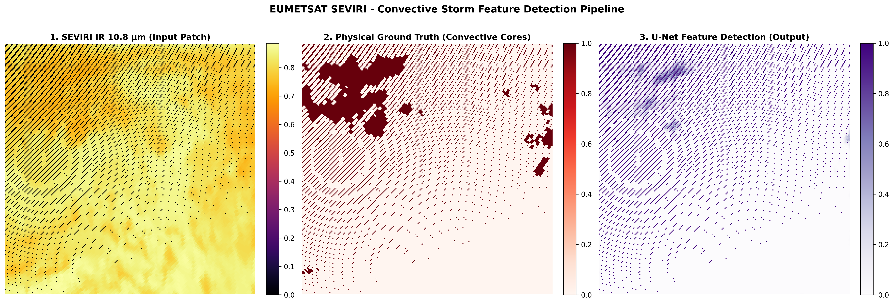

# ⛈️ EUMETSAT SEVIRI Convective Storm Feature Detection & ML Pipeline

[](https://www.python.org/)
[](https://pytorch.org/)
[](https://satpy.readthedocs.io/)
[](https://opensource.org/licenses/MIT)

An end-to-end Machine Learning and Earth Observation (EO) data pipeline developed to process raw geostationary satellite data and automatically detect severe weather features (convective storm cores) using deep learning.

This project was engineered to demonstrate core competencies required in modern operational meteorological environments: **Earth Observation data handling, ML-ready pipeline curation, domain-specific feature engineering and robust neural network deployment (PyTorch U-Net)**.

---

## 🎯 Project Objective & Background

Within operational meteorological agencies like **EUMETSAT**, transforming massive streams of raw geostationary satellite data (such as Meteosat SEVIRI Level 1.5 imagery) into actionable, real-time intelligence is vital for early warnings and nowcasting.

The goal of this project is twofold:
1. **Data Engineering EO:** Ingest, calibrate, crop and reproject raw binary satellite formats (`.nat`) using industry-standard libraries (`Satpy`, `Xarray`, `Pyresample`) to build reproducible, ML-ready spatial patch tensors.
2. **Feature Detection via Deep Learning:** Train a custom spatial **U-Net** architecture in PyTorch to map multi-spectral infrared channels directly to physical convective core masks, bridging meteorological domain physics with computer vision.

---

## 📊 Results & Visual Validation

The pipeline successfully ingests raw SEVIRI scans, isolates regional sectors of interest, extracts physical brightness temperature indices and trains a segmentation model to isolate convective cores.

Below is the comparative preview generated by the pipeline:



* **Panel 1 (SEVIRI IR 10.8 µm Input):** Normalized spatial patch extracted from the infrared channel, capturing cloud-top brightness temperatures (darker tones indicate colder, higher and more intense convective clouds).
* **Panel 2 (Physical Ground Truth):** Meteorological feature mask derived via physical percentile thresholds on cloud-top temperatures, isolating the true convective cores.
* **Panel 3 (U-Net Feature Detection Output):** Model inference output, demonstrating the U-Net's capability to accurately segment and predict storm locations.

---

## 🏗️ System Architecture & Data Flow

```text
┌────────────────────────────────────────┐
│  Raw EUMETSAT SEVIRI Data (.nat)       │
└───────────────────┬────────────────────┘
                    │
                    ▼
┌────────────────────────────────────────┐
│  Satpy & Xarray Ingestion / Cropping   │ ──► Geographic / Regional Subsetting
└───────────────────┬────────────────────┘
                    │
                    ▼
┌────────────────────────────────────────┐
│  ML-Ready Tensor Generator (PyTorch)   │ ──► Sliding Patches (256x256, 50% overlap)
└───────────────────┬────────────────────┘
                    │
                    ▼
┌────────────────────────────────────────┐
│  Custom Spatiotemporal U-Net           │ ──► Encoder-Decoder with Skip Connections
└───────────────────┬────────────────────┘
                    │
                    ▼
┌────────────────────────────────────────┐
│  Actionable Meteorological Mask        │ ──► Convective Core Segmentation & Verification
└────────────────────────────────────────┘
```

---

## 🛠️ Tech Stack & Dependencies

* **Earth Observation & Data:** `satpy`, `xarray`, `dask`, `netcdf4`, `pyresample`
* **Deep Learning:** `torch`, `torchvision`
* **Numerical & Visualization:** `numpy`, `matplotlib`, `cartopy`
* **DevOps / Containerization:** `Docker`, `pytest`

---

## 📥 Dataset Access & Download

Due to file size constraints (~250 MB) and licensing policy, raw satellite data is not tracked directly in this repository. Users can automatically download the sample native file via the official EUMETSAT Data Access Client (`eumdac`).

### 1. Obtain EUMETSAT Credentials
1. Register for an account at the [EUMETSAT User Portal](https://euportal.eumetsat.int/).
2. Generate your API credentials via the [EUMETSAT API Key Portal](https://api.eumetsat.int/).

### 2. Set Environment Variables
Set your credentials in your terminal environment before running the download script:

**Windows PowerShell:**
```powershell
$env:EUMETSAT_CONSUMER_KEY="YOUR_CONSUMER_KEY"
$env:EUMETSAT_CONSUMER_SECRET="YOUR_CONSUMER_SECRET"
```

**Linux / macOS:**
```bash
export EUMETSAT_CONSUMER_KEY="YOUR_CONSUMER_KEY"
export EUMETSAT_CONSUMER_SECRET="YOUR_CONSUMER_SECRET"
```

### 3. Download Sample Data
Install eumdac and run the download script:
```bash
pip install eumdac
python src/download_eumetsat_dataset.py
```

The script will automatically retrieve and place the following file into data/raw/:

   * MSG3-SEVI-MSG15-0100-NA-20261024141243.420000000Z-NA.nat

*Note: Keep your API credentials private and never commit them to public repositories. Data access is governed by EUMETSAT's terms and conditions.*

---

## 🚀 Quickstart & Reproduction

1. **Clone the repository:**
   ```bash
   git clone https://github.com/danielesilvitelli/EUMETSAT-SEVIRI-Convective-Storm-Feature-Detection-ML-Pipeline.git
   cd EUMETSAT-SEVIRI-Convective-Storm-Feature-Detection-ML-Pipeline
   ```

2. **Install dependencies:**
   ```bash
   pip install -r requirements.txt
   ```

3. **Run the pipeline & training on Colab/Local:**

   * Place your sample SEVIRI .nat file inside data/raw/.
   * Run the modular scripts inside src/ to execute data ingestion, patch extraction and model training.